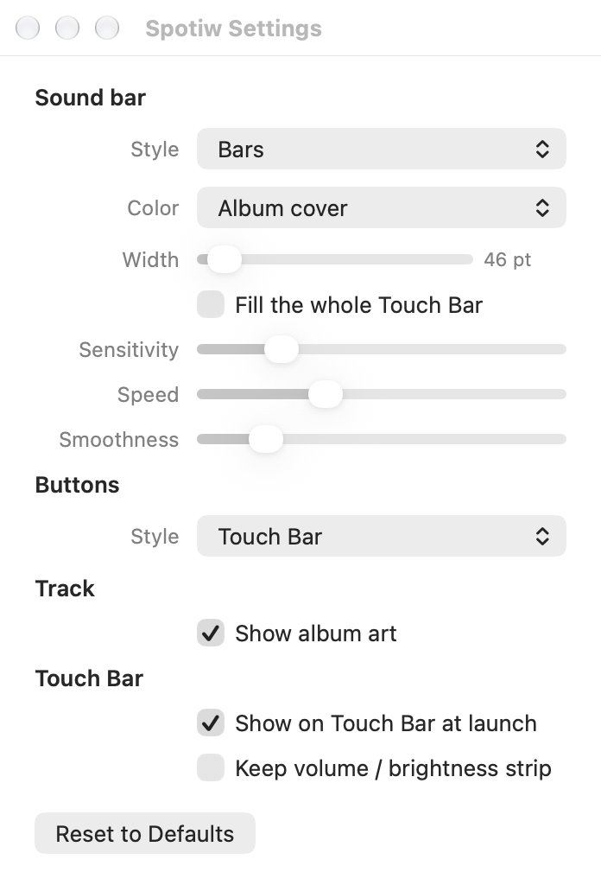

# Spotiw

Spotify on your MacBook Pro Touch Bar: track info, album art, playback controls,
a draggable progress bar and an animated sound bar that takes its colors from the album cover.


**[⬇ Download the latest version](https://github.com/Moryel/spotiw/releases/latest/download/Spotiw.zip)** · Intel and Apple Silicon · macOS 12+

> Spotiw 2.0 is a standalone menu bar app. **Pock is no longer needed.**

## Why it changed

Spotiw started as a widget for [Pock](https://github.com/pock/pock). That meant installing
and running a second app just to get one widget, depending on PockKit, and living inside
Pock's widget slot with little room to grow. A review of the 1.0 code also turned up
problems that were worth fixing at the same time:

- **Wrong album art.** The widget grabbed the first image it found in Spotify's cache folder,
  which was often not the cover of the song that was playing.
- **Restarting titles.** Long track names jumped back to the start every 5 seconds.
- **Heavy polling.** Every 5 seconds it started 2–3 `osascript` processes (one asking
  System Events for the full process list) and wrote temporary script files that were never deleted.
- **Buttons opening Spotify.** A tap anywhere on the widget, including the playback buttons,
  also brought Spotify to the front.

Spotiw 2.0 talks to the Touch Bar directly, the same way Pock does, and fixes all of the above.

## What's new in 2.0

| | |
|---|---|
| **No Pock** | A small menu bar app; a music note in the Control Strip opens Spotiw, the **X** returns to the normal Touch Bar. |
| **Native look** | Buttons use the system Touch Bar key style; play/pause shows the real state. |
| **Progress bar** | Elapsed and remaining time; drag it to seek anywhere in the song. |
| **Title and artist** | Two lines next to the album cover; tap them to open Spotify. |
| **Correct album art** | Downloaded once per track from Spotify's artwork URL. |
| **Album colors** | The sound bar is tinted with the cover's colors (dark covers are brightened so the bars stay visible), or with a fixed color. |
| **Resizable sound bar** | Any width from 30 to 400 pt, or fill the whole Touch Bar behind the controls. |
| **Lighter** | Track changes come from Spotify's own notification instead of polling: ~0% CPU when paused, ~2% while playing. |
| **Settings window** | Grouped settings, launch at login. |

## Gallery

**Playing** (default)


**Paused** — title dims, sound bar rests


**Wider sound bar** (220 pt)


**Sound bar across the whole Touch Bar**


**Wave style**


**Dots style**


**Filled buttons with a fixed green color**


**Keeping the volume / brightness strip**


## Settings

Open them from the music note in the menu bar → **Settings…**

<picture>
  <source media="(prefers-color-scheme: dark)" srcset="images/settings-dark.png">
  
</picture>

- **Sound bar:** style (bars, wave, dots), color (album cover or a fixed color), width or
  full Touch Bar, sensitivity, speed, smoothness
- **Buttons:** Touch Bar (native), icon, filled, pill, glass
- **Track:** show album art
- **Touch Bar:** show on launch, keep the volume / brightness strip

## Download

**[⬇ Download Spotiw.zip](https://github.com/Moryel/spotiw/releases/latest/download/Spotiw.zip)**
— works on every MacBook Pro with a Touch Bar (Intel 2016–2020 and Apple Silicon M1/M2),
macOS 12 Monterey or later, with the Spotify desktop app.

1. Unzip it and drag **Spotiw.app** into **Applications**.
2. Open it. Spotiw is free and not notarized by Apple, so the first time macOS blocks it:
   - **macOS 15 and later:** System Settings → Privacy & Security → scroll down → **Open Anyway**.
   - **macOS 12–14:** right-click Spotiw.app → **Open** → **Open**.

   Or, in Terminal: `xattr -dr com.apple.quarantine /Applications/Spotiw.app`
3. Allow Spotiw to control Spotify when asked
   (later: System Settings → Privacy & Security → Automation).
4. A music note appears in the menu bar and in the Touch Bar's Control Strip.
   Turn on **Launch at Login** from the menu bar icon to have it start with your Mac.

## Build from source

Requires the Xcode command line tools.

```sh
sh Scripts/build-app.sh            # builds build/Spotiw.app for this Mac
sh Scripts/build-app.sh install    # also copies it to /Applications and starts it
sh Scripts/build-app.sh release    # universal (Intel + Apple Silicon) build and build/Spotiw.zip
```

Coming from the Pock widget? Remove `Spotiw.pock` from Pock; your settings carry over.

## How it works

- Track, artist, play state, duration and position come from Spotify's
  `com.spotify.client.PlaybackStateChanged` notification. AppleScript is only used for
  commands (play, pause, skip, seek) and to fetch the artwork URL once per track.
- The progress bar advances locally between notifications and resyncs on every change.
- Showing a bar from a background app uses private Touch Bar APIs (DFRFoundation, the same
  ones Pock and MTMR use). They are looked up at runtime, so the app cannot go on the
  Mac App Store and a future macOS release could break it.

## License

See [LICENSE](LICENSE).
